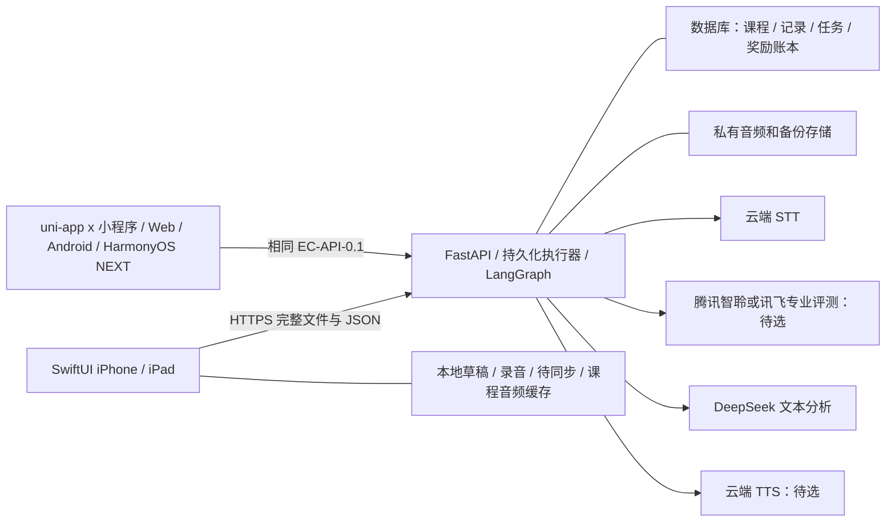

# 技术设计与唯一权威接口契约

版本：设计 v0.4 / EC-API-0.1，2026-10-11。状态：设计提案；路径、字段和状态未部署，供应商与设备验证尚未完成。产品规则以 ProductRequirements.md 为准；三仓库工程、主题和任务内部状态以 ProjectEngineeringStandard.md 为准，事实与未验证范围见 ProjectFacts.md。接口仍以本文件第5节唯一权威定义，不自行改路径、字段或枚举。

契约补充约束：不支持的 X-Contract-Version 返回 409 CONTRACT_VERSION_UNSUPPORTED，并说明支持版本，不能隐式降级。尚未选择的供应商与登录方式以待定附录表达，不伪造已存在实现。

## 1. 决策与仓库边界

确定：SwiftUI 原生客户端、Python + FastAPI + LangGraph 后端、uni-app x 跨端客户端三个独立仓库；后者覆盖小程序/Web/Android/原生 HarmonyOS NEXT。云端 AI 统一经后端访问；单题完整文件上传；专业发音评测必须使用原始音频。客户端不持有厂商长效密钥，不部署端侧模型，不做流式交互。后端未来运行个人服务器，本次不创建仓库、不部署或充值。

后端 Python + FastAPI + LangGraph 已由用户确定，不再换为 TypeScript/Mastra；小型单服务，可独立 worker。数据库仍待确认，PostgreSQL 仅候选建议。Windows 开发后端/uni-app x，Mac 编译签名 SwiftUI；登录、系统最低版本与跨端版本/编译模式待确认。没有必要引入微服务、Kafka 或独立大模型服务。

两客户端各负责界面、录音回放、权限、草稿、离线队列、音频缓存、反馈与收藏呈现，共享语义 tokens/素材/行为/契约但不共用 SwiftUI 与 uvue 源码。Web 录音单独 adapter，不假设内置 RecorderManager 支持 Web。后端负责身份与儿童权限、已学范围和每日固定计划、上传校验、评测编排、文本分析、TTS 缓存、服务端日历统计、奖励去重、同步与数据生命周期。账号和儿童档案仅有最小自用管理能力，首版不建运营后台。

### 1.1 工程模块与前端平台边界

Python后端按 accounts/children/courses/practice/evaluation/check_ins/rewards/exports 业务模块组织，模块内薄API、应用服务、规则/状态、repository、LangGraph workflow/node、provider adapter分责；DI在组合根，事务/唯一约束/revision归数据层，超时/重试/预算与真实调用记录由执行边界协调。路由不堆SQL/厂商逻辑，工作流不写打卡奖励事实，单体可独立worker，不用无必要微服务。

SwiftUI/uvue页面只组合业务状态与共用组件；录音/播放/文件/权限/login/theme-storage按平台adapter隔离。SwiftUI与uvue不同源码，共享token schema、许可素材、组件合同、API类型与规则。button/dialog-sheet/toast-banner/form/list-pagination/card-container/recorder/feedback/calendar/reward都明确定义input/output、loading/empty/error/disabled、防连点、焦点键盘安全区及响应布局；mobile加载更多与desktop分页保留一致数据语义。

uni-app x固定版本/编译模式后验证共同样式子集Flex/绝对定位，不把DOM、任意CSS或Vue Transition当四端能力；Web录音独立实现，内置RecorderManager不支持Web。原生HarmonyOS NEXT单列编译/权限/文件/录音验收，不能拿Android APK替代；供应商/平台mock只验编排。

### 1.2 主题配置与样式存储

十套主题完整token值/组合以 ProjectEngineeringStandard.md 第6节唯一来源，theme ID UpperCamelCase；设备group存储键 sky/mist/lavender/peach/lemon，mode system/light/dark。默认sky/system，暖白浅蓝B对应SkyLight，系统深色为SkyDark。每个客户端映射到自己的Color/UTS/CSS样式，不复制各自另改色表；主题按设备保存，不新增EC-API-0.1服务器字段/接口，也不进sync/backup业务数据。

消费覆盖全部背景/文字图标/按钮/链接/选中焦点/交互状态/边界遮罩阴影/四语义状态与录音进度日历奖励。已打开弹层等订阅当前主题，禁止页面硬编码。主按钮accent/#14243B及必要边界遵守对比，半透明若承载内容须合成计算，不能拿装饰阴影当控件边界。通用字号/间距/圆角/48逻辑触控/动态字号/安全区与动画规则按项目规范执行，不统一物理像素。

### 1.3 编码门禁与工具能力

所有手写代码多行职责/公共API/复杂状态注释；Python真正AST docstring可排除，prompt/SQL字符串计代码；普通空白行计入、注释不计、inline代码仍计1。type/class间恰好2空行、function/method间1、类型与函数边界优先2，无超过2；Python有意覆盖PEP8顶层函数2空行默认。UTF8无BOM/LF、末尾单换行、无尾随空格/tab；py/Swift/PS4空格，UTS/uvue/CSS/JSON/YAML2，命名按语言/框架规定，机器JSON不能插非法注释。

有效行阈值、方法30/50、类型150/200（跨extension）、SwiftUI body60、业务嵌套<=3/复杂度<=10和具名例外见通用/项目规范。计数用tokenizer/AST/可靠parser，不能regex剥字符串或排除全部tests/migrations。唯一pipeline为基准formatter→AST安全空行归一→custom checker→lint/type/tests，整体幂等而非两套formatter互打；checker与UTS/uvue兼容尚待实现验证，不能声称SwiftLint/Ruff默认覆盖全部规则。

## 2. 数据、存储与一致性

逻辑实体：Parent、Child、CourseEdition、Lesson/KnowledgePoint、ContentVersion、Progress、DailyPlan、Attempt、AudioObject、EvaluationJob、CheckIn、RewardGrant、CollectionItem、SyncChange、DataJob。实体名不是要求建立等量独立表或 CRUD；可按简单实现合并。

Child 带 parentId、固定业务时区和录音保留策略。Progress 带 revision 和确认过的已学范围；DailyPlan 保存题目与素材版本快照、dayMode 和 completionPolicy；同一儿童/目标日期基础计划唯一，额外题有独立标记。教材进度可回退修订但须家长确认和版本检查，已完成记录不能因后续教材修改而改写。

Attempt 带客户端 UUID、planId/itemId、选择的最终录音、原始识别文本、家长确认文本及版本、评测组件状态。重录产生新 attempt，计划条目只指向最终选择，不重复累计。CheckIn 唯一键为 childId + targetDate；RewardGrant 使用产品规则对应的事件唯一键，事务中写打卡、账本和同步事件。

所有数据库时间使用 UTC。targetDate 是 YYYY-MM-DD 业务日期，建议固定 Asia/Shanghai，不能从设备当前时区直接推断。clientCompletedAt 只为客户端声明；confirmedAt 是服务端时间，两者区分。日期、连续链、补卡、累计与月度奖励都由服务端返回。

本地存储建议选择系统支持、最低系统兼容的简单持久化方案，待系统核对再决定 SwiftData/Core Data 等；音频独立文件存放，数据库保存引用。已确认数据可清缓存；未同步草稿与录音不得因普通缓存清理丢失。系统备份排除可重建课程缓存，敏感录音的系统备份行为在隐私说明列明。登出/账号切换隔离本地队列与加密令牌。

服务器音频私有保存，不能用公开永久 URL。短期处理音频至少保存到终态和有界重试/申诉窗口结束；长期保留按家长选择。处理中取消/删除优先于结果回写。临时上传、孤儿文件、已终止任务、缓存与备份均有清理策略；具体期限待确认，不使用无限期默认。私有存储可先服务器磁盘，需空间额度、原子写入、备份和磁盘故障方案，不强制对象存储。

离线边界：服务端Plan快照及必需素材已缓存时才能离线继续正式基础练习；首次安装无计划、新课未由服务端确认或题目缺失时不承诺离线打卡。可保存明确的本地复习草稿，联网后与合法Plan核对，不静默更换题目并宣称同一练习已完成。uni临时录音路径须立即转存可用的持久目录；Web按浏览器quota/持久存储能力处理并提示可能被系统清理，不能保证清缓存后仍恢复录音。

## 3. 音频与云端编排

SwiftUI先验证 AVFoundation；uni-app x各端及Web分别记录实际编码/容器/MIME与文件能力，不把M4A设为所有端必备格式。AAC/M4A单声道仅是Apple端候选；后端保留原始文件，按供应商要求转换为 PCM/WAV 等格式。采样率、码率、最大秒数/字节数需结合设备和厂商实测固化，契约 configuration 返回限制，不能盲定统一厂商格式。检测文件真实编码/可解码性、时长、体积、哈希；不信扩展名和 Content-Type，不允许任意远程音频 URL、路径穿越或解压炸弹。音频转码受时间和资源限制。

跟读流水线：上传原始音频 → 专业评测(referenceText + audio) → 将专业结果转为儿童一个重点与家长详情；DeepSeek 可解释有依据的结果，不能生成不存在的音素证据。

自由表达流水线：上传 → STT 原话 → 在可解释原话足够清楚时 DeepSeek 语法/用词分析；专业发音可独立并行。腾讯自由说若能同时返回识别词与评测，是否省单独 STT 需真实样本检验，不能预先保证。识别供应商无置信度时字段为空，不模拟。STT 输出保存 providerTranscript 与 provenance，给儿童的纠正句保存 correctedText，不覆盖原话；家长确认文本记录 revision/source。

识别质量 insufficient/needs_review 时语法任务为 skipped 或等待确认；这是产品安全判断，并非伪造供应商置信度。判断方法需可解释，例如录音无法解码/空转写/人工标记；不能用不可靠启发式对孩子扣分。云端提示词把转写当数据，限定 JSON 输出、英语学习范围和最多一个重点，校验 schema；录音或文本内的指令不能改变权限、费用和系统行为。

TTS：固定课程示范预生成、人工听审、按许可长期保存与 App 缓存；动态纠正示范按需生成。复用键由规范化文本 + language + voiceId + rate + provider + model/version + 合成配置组成；只做无损空白规范化，不改变英语表达。命中时跳过合成；失效按内容版本重建。私有输出通过授权短效下载，课程可发布经许可的公共素材但不得混入儿童音频。首版返回完整音频，不增加流式协议。

持久化任务由单服务有界工作池或独立 worker 调度，租约/revision/超时/崩溃恢复/有限重试负责执行；LangGraph 保存评价节点与 checkpoint，不替代调度器或业务数据库，不能保证 exactly-once。供应商非幂等调用遇到结果不明不能盲目重试多扣费，记录调用步骤、版本、预算与 externalRequestId（若真实存在）供受控 reconcile。只重试失败步骤，已成功结果复用。每儿童/家长/供应商设置次数、并发、字节和费用预算，调用前预留预算，完成结算，日志不记录音、全文敏感转写或密钥。不承诺固定等待时长。

## 4. 状态机

| 对象 | 状态与规则 |
| --- | --- |
| 本地练习 | draft → recorded → queued → syncing → confirmed；失败保留 pending/retryable，账号不匹配不上传 |
| 音频 | received → validated → processing → retained/deleted；invalid 不进入评测；删除状态不回退 |
| 每评测组件 | pending → running → succeeded / failed / skipped / cancelled；重试增加 attemptCount，不生成新奖励 |
| EvaluationJob API | 保持 EC-API-0.1 queued → running → succeeded / partial / failed / cancelled；unsupported 组件 skipped + reason；允许组件先返，所有组件终态才汇总终态 |
| EvaluationJob 内部 | queued/running/retry_wait/succeeded/partial_success/failed/cancelled 的合法转移见新规范；partial_success 映射 partial，retry_wait 映射 queued，不增加 API 枚举 |
| CheckIn | 本地 pending → 服务端 confirmed；评测状态与打卡状态独立，不要求 job succeeded |
| DataJob | queued → running → ready / failed / cancelled；删除额外使用 completed；ready 文件有 expiresAt |

job partial 表示请求的组件中部分成功部分失败；被能力声明排除的 skipped 不算技术失败。attempt 已上传但评测失败仍可完成计划；离线完成在同步时提交完成证据和可上传录音，拒绝评测不会取消有效打卡。任何失败都返回可行动原因和 retryable，不让客户端以字符串猜错误。

汇总边界：skipped/UNSUPPORTED表示未评价而非正确；若所有有效请求组件都skipped，不展示“评价成功”或分数。在现有API枚举中使用failed并通过组件reasonCode表明NO_USABLE_EVALUATION等原因，附skipped明细，不引入新enum；这表示没有可用评价，不等于孩子回答错误或打卡失败。grammar等待人工确认必须有最大等待/任务收束策略，不能让pending无限阻塞终态。明确的cancelled优先，所有失败为failed，成功与失败混合为partial；保留被跳过组件的原因。

## 5. EC-API-0.1：通用契约

本节是唯一权威初稿。三仓库生成的 OpenAPI/schema/fixture 必须派生于它，后续由 Python 后端仓库维护 canonical contracts，两客户端复制相同版本并记录哈希；规划阶段本文件权威。开发前将完整 schema 的枚举、必填/可空、分页和限制补齐到同一版本，不能让各窗口自行补成不同接口。

基址待定；设计路径统一 /v1。JSON UTF-8，字段 camelCase；自有实体ID为UUID字符串，外部/素材标识按schema定义，时间 ISO-8601 UTC，日期 YYYY-MM-DD。请求含 X-Contract-Version: EC-API-0.1；响应含 contractVersion、requestId、serverTime。读响应统一 data；列表 data.items + nextCursor（无更多时 null）。命令成功返回相应实体或 job；不使用 200 包裹业务失败。二进制端点明确例外。未识别响应字段可忽略，未知枚举必须显示安全降级，不默认为成功。

除登录握手（待定）外均需 Authorization: Bearer <app-session-token>；令牌是本 App 会话，不是供应商密钥。家长账号有权管理其 Child；禁止单凭 childId 授权，所有对象查询/下载均校验归属。登录、会话刷新/撤销及账号创建流程待认证方案确定后作为同一契约的附录；开发身份只允许本机开发，不能用于生产部署或正式联调验收。

所有修改命令包含 Idempotency-Key，建议 UUID；同账号 + 方法 + 路径 + key + 规范化业务请求摘要绑定。JSON按固定规范化规则，multipart按解析字段及实际文件哈希计算；不把随机boundary、字段顺序或客户端来源/追踪header纳入摘要。相同请求重放原结果；同 key 不同请求 409 IDEMPOTENCY_CONFLICT。保存期限至少覆盖离线重放期，具体值在 configuration 公布；业务唯一约束提供永久日期/奖励去重，不能靠幂等 key TTL 单独保证。revision 冲突 409 VERSION_CONFLICT，携带 currentRevision 和可获取最新对象的资源 ID。

错误体：error { code, message, retryable, details? } + requestId + contractVersion + serverTime。message 面向家长/开发者，儿童提示由客户端映射。常用 HTTP/错误码：400 INVALID_ARGUMENT；401 AUTH_REQUIRED/SESSION_EXPIRED；403 FORBIDDEN；404 NOT_FOUND（跨账号对象可统一用此）；409 VERSION_CONFLICT/IDEMPOTENCY_CONFLICT/PLAN_CONFLICT；413 AUDIO_TOO_LARGE；415 AUDIO_FORMAT_UNSUPPORTED；422 AUDIO_INVALID/DATE_NOT_ALLOWED/PLAN_NOT_COMPLETE/BACKUP_INVALID；429 QUOTA_EXCEEDED（Retry-After 若可知）；503 PROVIDER_UNAVAILABLE；504 PROVIDER_TIMEOUT。异步供应商错误通常存入 job component，不让轮询 GET 变成 5xx。敏感凭据与供应商原始异常不进入 details。

### 5.1 身份、档案、配置和课程进度

客户端来源与可观测性补充见 [客户端上下文、统计与请求追踪](./ClientContext.md)：统一网络模块注入可选 clientType/clientPlatform/版本等 headers，后端集中解析，响应 X-Request-Id 与 JSON requestId 一致；任务保留创建来源。该附录是 EC-API-0.1 可选元数据扩展，不修改业务 DTO、状态枚举、授权或幂等规则，也不把客户端来源作为用户身份。

| 设计操作 | 请求/返回核心字段 |
| --- | --- |
| GET /v1/bootstrap | data: parentSummary、children[]、configuration、capabilities、syncCursor；configuration 含 timezone、audioLimits、idempotencyRetention、makeupPolicy、rewardRuleVersion；capabilities 含真实可用 stt/pronunciation/TTS/report 能力，不是营销列表 |
| POST /v1/children | displayName（建议昵称）、recordingRetentionChoice；返回 Child {id, revision, timezone, retentionPolicy}；账户恢复信息不置于 Child |
| PATCH /v1/children/{childId} | expectedRevision + 可更改昵称/保留策略；返回新 revision；新策略对历史音频的处理范围需明示确认 |
| GET /v1/courses | 可用且已获许可的 CourseEdition 摘要；未准备的教材不能展示成已可用 |
| GET /v1/children/{childId}/progress | courseEditionId、confirmedLessonIds/knowledgePointIds、revision、confirmedAt |
| PUT /v1/children/{childId}/progress | expectedRevision、courseEditionId、confirmedLessonIds、parentConfirmed=true；后端校验课次与教材归属，生成已学知识点，不接收客户端任意知识点 |
| POST /v1/children/{childId}/plans | targetDate、dayMode: new/review/unknown、expectedProgressRevision、confirmedNewLessonId?、parentConfirmed?；new 需显式确认，原子更新进度和生成固定基础计划；返回 Plan |

Plan {id, childId, targetDate, revision, dayMode, courseEditionId, contentVersion, progressRevision, estimatedSeconds, items[], completionPolicy}；item {id, type: repeat/free_expression, knowledgePointIds[], referenceText?, prompt, suggestedSeconds, exampleAudioId?, required}。completionPolicy 含必须处理条目、允许跳过的原因枚举及规则版本，不以录音时长或分数门槛判打卡。已有基础计划重请求返回它；不同输入不默默替换，返回 PLAN_CONFLICT 和 existingPlanId。额外题 POST /v1/plans/{planId}/extras，返回额外条目，不改基础完成条件和奖励。

### 5.2 上传、尝试和评测

POST /v1/audio：鉴权 multipart/form-data，字段 childId、planId、itemId、clientAttemptId、sha256 与 file，整文件上传，体积受 audioLimits 限制；返回 AudioObject {id, status, detectedFormat, durationMs, sha256, expiresAt?, retentionPolicy}。服务端实际计算哈希并比对；重复相同上传可返回原对象，不按客户端哈希跨账号复用。首版无分块或客户端流式协议。

POST /v1/attempts：clientAttemptId、planId、itemId、audioId、clientCompletedAt；返回 Attempt {id, revision, selected, evaluationJobId?, evaluationState}。referenceText/type 从计划快照读取，不接收客户端自定义文本覆盖专业评测基准。明确上传/attempt 的归属与条目一致。创建 attempt 可以自动启动一次任务；客户端不再额外启动重复任务。

GET /v1/evaluations/{jobId}：返回 Job {id, attemptId, status, components {stt, grammar, pronunciation}, feedback?, nextPollAfterMs}。每 component {status, reasonCode?, retryable, provider?, result?}；stt.result {providerTranscript, transcriptSource, transcriptRevision, quality: usable/needs_review/insufficient, confidence?: number|null}；confidence 仅供应商确实提供且说明尺度时存在。grammar.result {originalText, correctedText?, childTip?, encouragement, parentDetails?}；pronunciation.result {providerScale, providerScore?, wordDetails?, phonemeDetails?, evidenceAvailable}，细节只有真实返回才有。反馈不把数值当成功门槛。

PUT /v1/attempts/{attemptId}/transcript：expectedRevision、confirmedText、parentConfirmed=true；记录人工确认与新 revision，受预算控制创建新分析版本；不篡改 providerTranscript。POST /v1/evaluations/{jobId}/retry：components[]、expectedAttemptRevision；仅可重试允许的失败组件，同请求去重，不能客户端传 provider 任意试刷。未接入自由表达发音时 skipped/UNSUPPORTED，不返回模拟分数。

### 5.3 完成、日历和收藏

POST /v1/children/{childId}/check-ins：planId、targetDate、clientCompletionId、clientCompletedAt、planRevision、itemOutcomes[] {itemId, outcome: completed/skipped, attemptId?, localAttemptId?, skipReason?}。离线项没有服务器 attemptId 时允许 localAttemptId 关联待上传；不以评测成功为前提，服务端检验计划/日期/条目和规则，可标 feedbackPending。若无法上传麦克风片段，合法 skipReason 由 completionPolicy 指定，不伪造录音。

返回 CheckIn {id, targetDate, clientCompletedAt, confirmedAt, isMakeup, feedbackPending, revision}、calendarSummary {todayCheckedIn, uniqueCompletedDates, currentStreak, longestStreak}、rewardGrants[]、collectionRevision。重复日期返回已有确认状态，不额外奖励；追加练习附在记录上。targetDate 必须等于 plan.targetDate；补卡使用相同端点，日期早于确认日且符合 makeupPolicy，明确 isMakeup，无另一套奖励接口。

GET /v1/children/{childId}/check-ins?fromDate=&toDate=&cursor=：按目标日期列记录和补卡标记；GET /v1/check-ins/{checkInId}：反馈摘要、attempt 引用、可播放 audioId（可能 null/deleted）；GET /v1/children/{childId}/collection：items {id, kind: tank/part/badge/decoration, unlocked, unlockedAt?, sourceTargetDate?, ruleVersion, title, assetId?, historySourceUrls[] }、nextMilestone。历史素材来源属于内容管理，不能返回未授权第三方图片。客户端不提交 unlock=true。

### 5.4 完整音频与同步

POST /v1/tts：childId、purpose、text?、contentItemId?、voicePreference?、rate?。固定素材按 contentItemId 校验版本；动态纠正只允许关联有效 attempt 的纠正示范用途（追加 attemptId），不能暴露无限公共 TTS。命中返回 AudioAsset；需生成返回 data.jobId/status，GET /v1/tts-jobs/{jobId} 得到终态 AudioAsset {audioId, contentVersion, cacheKeyVersion, mediaType, durationMs?}。voice/rate 必须在配置许可范围。

GET /v1/audio/{audioId}/access：授权后返回短效 downloadUrl、expiresAt、sha256、mediaType；课程缓存到期可重新获取访问权；儿童录音删除后不再可用。URL 不带供应商密钥，不把令牌打印日志。后端可代理二进制下载或短效签名下载，两端在 canonical schema 中固定其中实现，不让客户端拼路径。音频访问不重新扣 TTS 合成费。

GET /v1/sync?cursor=：仅当前家长 data {changes[], nextCursor, hasMore, resetRequired}；change {entityType, entityId, operation: upsert/delete, revision, data?}，包含打卡、进度、评测结果和收藏变化。游标为服务端不透明字符串，不用设备时间排序。过期游标 resetRequired=true 后重取 bootstrap + 有界列表，保留未确认本地队列，不能全盘覆盖。客户端修改通过上述命令发送，不另造通用任意表写入接口。删除 tombstone 留存期覆盖离线窗口；恢复导入导致 resetRequired 时明确返回。

### 5.5 导出、恢复、月报和删除

POST /v1/children/{childId}/exports：kind: backup/monthly_csv/monthly_pdf、dateRange?、includeAudio: retained/none（仅 backup）、schemaVersion。返回 DataJob；GET /v1/data-jobs/{jobId} 返回 status、summary、artifact? {downloadUrl, expiresAt, sha256, schemaVersion}。backup 含 manifest 与各文件哈希、课程/进度/日期/反馈/奖励证据/录音清单和缺失理由；报告不是备份。不导出令牌、API 密钥、跨账号数据。PDF 可在后续阶段 capability 明示未可用，不能假回空 PDF。

POST /v1/children/{childId}/imports/preview：鉴权 multipart 完整备份上传，校验体积/压缩展开限制、schemaVersion、哈希与路径安全；返回 importId、expiresAt、summary、conflicts[]、missingAudio[]、mappingRequirements、previewRevision。POST /v1/children/{childId}/imports/{importId}/commit：previewRevision、expectedChildRevision、strategy: merge、conflictResolutions[]、parentConfirmed=true；异步 DataJob。每个冲突选择保留已有/采用导入，不支持首版隐式全覆盖。只能映射到当前家长有权儿童；恢复打卡日期去重、奖励按规则重建，导入 claimed unlock 不直接信任。manifest 哈希证明完整性，不能证明用户上传记录真实；产品是家庭自用，仍不得将导入内容视作可兑现价值。

POST /v1/deletions：scope: audio/child/account、resourceId、expectedRevision?、parentConfirmed=true；scope=account 须重新认证，具体方式由认证附录确定。返回 DataJob，完成 summary 列数据库、文件、缓存、任务、供应商请求/残留期限与备份到期计划，不能声称已从供应商或未到期备份即时抹除。取消未完成任务，删除 tombstone 优先，防止迟到任务回写。导出 URL 与播放 URL 失效时间受签名短效期限约束；需要即时撤销时通过鉴权代理，验收须明确实际保证。备份轮换到期前限制访问，恢复旧备份不得自动复活删除对象。

晚到录音与恢复提交约束：离线打卡中的 localAttemptId 必须与后续 clientAttemptId 相同；创建 attempt 时按儿童/计划/条目关联该待反馈记录，更新详情与 sync，不创建第二次打卡或发奖。导入 preview 保存受影响实体的 revision 快照，commit 时逐项复核；期间发生变化需重新预览。导入数据库记录、奖励去重与 sync 变更应事务提交，音频先校验暂存再发布；失败保留清理标记，不能显示部分导入为全部成功。

### 5.6 契约冻结前必须补齐的缺口

当前EC-API-0.1仍是设计初稿，以下为同一权威schema的待细化清单，不是已经实现或悄悄新增的接口；开始相应功能开发前给出具体提案/fixtures，同步三仓库，不让窗口自行发明字段。

| 缺口 | 冻结要求 |
| --- | --- |
| 重录与最终选择 | 明确提交后重录、selected唯一约束、跨端同时提交、expectedRevision、旧评价迟到与selected变更关系；客户端提交前本地重录不调用付费评价。新增选择命令/字段须进入版本化提案，未定前只实现提交前选择，不默认“最后响应胜出” |
| 课程与计划读取 | 课程摘要不足以让家长选课次；补齐教材目录/课次摘要及已有Plan读取方法、内容版本与素材引用，避免只有创建命令却无法恢复。用最小资源/响应扩展，不创建通用CRUD |
| 同步快照 | bootstrap/list/sync需有一致快照边界和对应cursor，保证分页期间写入不丢失；记录排序/同时间tie-break、cursor过期/撤权、resetRequired的重建顺序与未确认队列合并 |
| 通用schema | 固定audioLimits、completionPolicy/skipReason、capabilities、所有ID格式、必填/可空、分页上限/排序、HTTP成功状态码、二进制例外、TTS立即返回或job的可判别响应形状；UUID仅指自有实体ID，厂商ID/素材键按各自schema |
| 任务与反馈版本 | 定义人工修订/显式retry的执行版本、旧job查询与新结果关联、selected变更回写条件；stt等非适用组件skipped，不能把其缺少数据当低分 |
| 登录与恢复 | 六平台身份入口最终归一到同一家长账号，微信身份不自动等于其他端账号；刷新、撤销、恢复和敏感重认证附录在真实联调前确定 |

奖励去重补充：ruleVersion是审计快照，不可作为唯一防重因素。相同儿童、逻辑奖励权益与目标日期/月/里程碑保持稳定授予标识；配置升版不自动再发同一奖励。规则迁移、新权益与已得权益的处理须显式定义，导入后不能靠换版本绕过已得记录。
删除与恢复补充：tombstone阻止自动同步/服务器备份恢复复活对象；家长主动导入若命中删除记录，preview必须显示冲突并明确选择，默认保留删除，不静默覆盖。重新建立已删除内容须按当前授权和新资源身份处理，不恢复旧访问令牌或旧任务；账号删除后不凭历史备份重新授权。

## 6. 安全与运维边界

厂商密钥只在后端受保护配置，样例仅变量名；App 会话凭据经平台安全存储adapter管理：Apple用Keychain，Android/Harmony使用已验证的安全存储方案，Web/小程序按认证方案确定暴露与持久化边界，不默认普通localStorage等同Keychain；不把 .env、音频、儿童转写、备份、凭据提交 Git。TLS、请求大小/时长、权限、资源归属、费用预算、幂等和并发均由后端强制；家长管理入口不能只靠一个儿童能随意通过的本地按钮保护敏感删除。

备份文件含敏感数据，应保护下载和本地保存，文档说明未加密 ZIP 的风险；建议提供密码加密容器或系统安全分享，实际方案与恢复工具一起验证，不臆造已加密。导入不能信任供应商分数、奖励数量或归属字段。生产服务器与登录方式待定，未通过身份、安全、备份恢复和删除验收不得以演示身份上线。此计划不授权外部发布、购买或充值。

LangGraph隐私补充：checkpoint/state/store也是持久化数据，按家长/儿童/job/executionVersion隔离；优先保存受控资源引用和必要结果，不复制原始音频或无限保存敏感转写。删除流程覆盖checkpoints、步骤缓存、调用记录中的敏感字段和过期备份；禁止将含儿童内容的trace自动发送第三方。首版选持久化checkpointer并设迁移/清理策略，MemorySaver不作为重启恢复证据。参考[LangGraph持久化](https://docs.langchain.com/oss/python/langgraph/persistence)，2026-10-11核对；此为数据边界设计，尚未实现。

## 7. 联调、选型与完成证据

canonical 契约由Python后端仓库维护，SwiftUI与uni-app x两客户端以版本和哈希确认；改动列原因、前后字段、兼容性、三仓库影响、fixture与验收项，不兼容变更经用户确认再实施。先冻结schema/mock fixture再各仓库实现；假服务显著标记。阶段验收分别标记schema/mock、本地真实后端、真实云端、各目标端编译/真机、生产，不能混为“通过”；本次均无实际开发或部署验收。

必须覆盖事务竞态、重复请求、部分评测先返/失败、无置信度转写、离线跨日/跨设备、恢复冲突、删除/取消迟到回包、上传安全、越权、预算/重试上限、租约和checkpoint恢复。内部retry_wait映射API queued、partial_success映射partial，无新enum；只有失败步骤重试且成功调用不重复付费。费用/延迟记录样本/时间段/请求数/成功失败/重复调用/账单，不外推固定月费。主题另验十套主要组件与弹层即时切换、设备存储、动态字号/焦点键盘/安全区/减少动态效果；Mac与uni-app x四目标端逐项报告实际版本/编译模式/测试能力，不以数学配色验收代替UI。

真实供应商比较需同批经家长授权录音、人工参考、匿名样本 ID：正确、错误、漏词、噪声、自由表达、重复样本；记录误报/漏判与识别保真、稳定性、处理耗时分布和费用。厂商分数各自解释，不归一化成看似科学的统一音素准确率。凭据不足则报告“未真实验证”及配置步骤，不自动充值或假装 mock 等于选型通过。

## 8. 来源与既有项目参考

以下为历史只读查证的来源入口；本次审阅仅重新核对报告列明的LangGraph/CORS及uni录音说明，未重新核查全部供应商文档，也没有构建或调用供应商接口。开始真实集成时应核对官方当前文档、账号权限、版本与数据政策，保存查证日期，不能把页面存在当服务已可用。

- [DeepSeek API 文档](https://api-docs.deepseek.com/)：交接查证的公开对话接口未列音频输入；本方案只将其用于转写文本分析。
- [Kimi 开放平台](https://platform.moonshot.cn/docs)：会员、Kimi Code 与开放平台 API 余额/密钥不能互当；真实账户权限须核对。
- [腾讯智聆口语评测文档](https://cloud.tencent.com/document/product/884) 与 [讯飞开放平台](https://www.xfyun.cn/)：首轮专业发音候选，尚未选定或实测。
- [MeteorVoice TTS 集成说明](https://github.com/JunchenMeteor/MeteorVoice/blob/main/docs/tts-integration.md)、[TTS 路由](https://github.com/JunchenMeteor/MeteorVoice/blob/main/apps/web/app/api/tts/route.ts)、[服务适配](https://github.com/JunchenMeteor/MeteorVoice/blob/main/apps/web/lib/server/tts.ts)：交接只读核对包括鉴权、输入校验/限制，以及讯飞/火山/腾讯/Azure 适配入口。
- [讯飞适配](https://github.com/JunchenMeteor/MeteorVoice/blob/main/apps/web/lib/providers/xunfei-tts.ts)：分块 buffer 收集后返回完整 MP3；不意味着客户端流式。旧文档部分英语试用音色标注 6 月过期，必须确认当前账号权益。
- [火山适配](https://github.com/JunchenMeteor/MeteorVoice/blob/main/apps/web/lib/providers/volcengine-tts.ts)：仅历史参考；用户暂不考虑豆包，首版不新增此选型。
- [音频缓存](https://github.com/JunchenMeteor/MeteorVoice/blob/main/apps/web/lib/server/tts-audio-cache.ts)：合成后存储、播放 URL、TTL/容量清理；不是按文本命中跳过合成。本方案需新增真正复用索引。
- [ASR provider layer](https://github.com/JunchenMeteor/MeteorVoice/blob/main/docs/asr-provider-layer.md)：交接说明讯飞远端为诊断路径，生产 mobile 仍 expo native speech；不能视作现成云端 STT 或专业发音评测。

后端已选 Python，MeteorVoice 的 TypeScript 适配仅作协议/行为参考，不能直接当 Python 可运行实现；重新实现 adapter 时核对许可与当前厂商文档。不得修改 MeteorVoice、移植其 React Native 界面或整套 Next.js/Supabase/流式会话体系。Apple 硬件信息、教材版本和课程素材另由实际设备/合法内容核验，本文件不假造最低系统或教材页内容。
